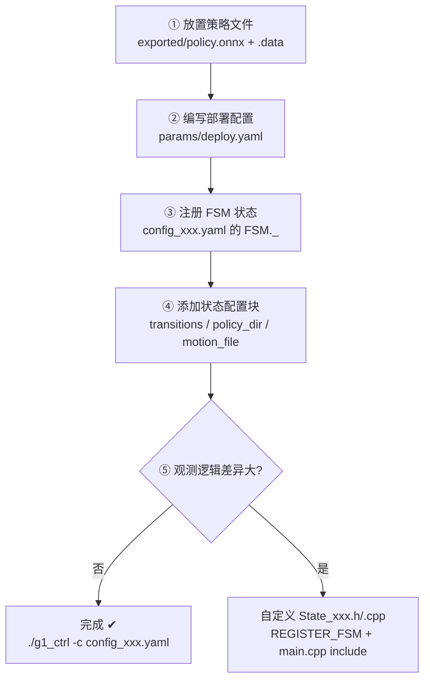
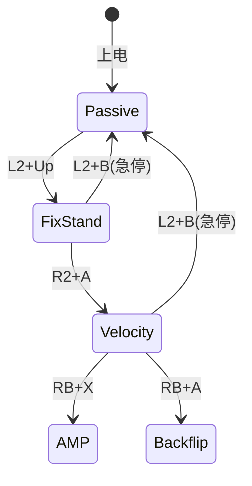
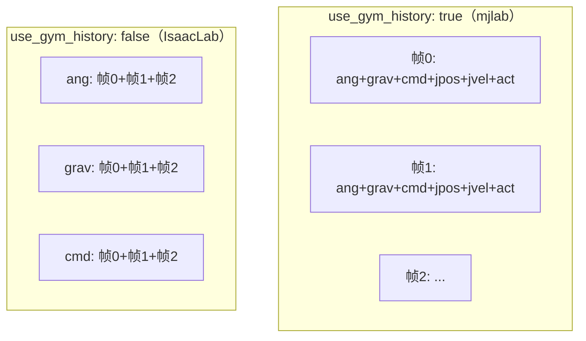

# 组会汇报 PPT 设计方案与内容资料

> 主题：基于 MJLAB 的机器人策略部署全流程 —— sim2sim / sim2real / 实机部署方法教程
> 定位：工程实践教程（不涉及原理分析、不涉及复杂功能逻辑）
> 用途：供在其他电脑（Windows/WPS/PowerPoint）上制作 PPT 使用
> 汇报时长建议：15 ~ 20 分钟

---

## 一、PPT 概览

| 项目 | 建议 |
|------|------|
| 总页数 | 20 页左右 |
| 配色 | 深蓝 + 白 + 橙色点缀（科技感），也可用宇树品牌色（黑/白/红） |
| 字体 | 标题用微软雅黑 Bold，正文用微软雅黑/思源黑体 |
| 风格 | 扁平化，多流程图/表格，少大段文字 |
| 动画 | 少量淡入，重点页面（5 步法、观测分解）可用逐步出现 |

---

## 二、整体结构（20 页）


---

## 三、逐页内容设计

### 第 1 页 · 封面
- **大标题**：基于 MJLAB 的机器人策略部署全流程
- **副标题**：从训练到实机 —— sim2sim / sim2real 部署方法教程
- **落款**：汇报人：XXX　|　日期：XXXX-XX-XX
- **配图**：【占位】一张 G1 实机照片或宇树 logo（背景图）

---

### 第 2 页 · 汇报大纲
用简洁列表（可做成导航式卡片）：
1. 框架简介与整体流程
2. 环境搭建与仓库拉取
3. 训练一个策略（简述）
4. 接入新策略：5 步法（文件 → 配置 → 注册）
5. 观测体系详解（速度类 / 动作模仿类 / 历史观测）
6. FSM 状态机逻辑与工程实现
7. Sim2Sim 仿真验证
8. Sim2Real 实机部署
9. 注意事项与常见坑

---

### 第 3 页 · 框架简介与流程总览
**要点：**
- MJLAB = MuJoCo 物理引擎 + Isaac Lab 风格高层 API 的轻量化 RL 框架
- 支持机器人：Go2 / A2 / As2 / G1 / R1 / H1_2 / H2
- 本汇报以 **G1（29 自由度）** 为例
- 强化学习运动控制的基本流程：**训练 → 仿真验证 → 仿真到实机**

**流程总览图：**


**配图**：【占位】左：仿真 g1-velocity.gif；右：实机 g1-velocity-real.gif（README 的 doc/gif/ 下已有）

---

### 第 4 页 · 环境搭建与仓库拉取
**要点（工程命令，直接可抄）：**

1. 系统要求：Ubuntu 22.04，Nvidia 显卡（驱动 ≥ 550）
2. 拉取仓库 + 建环境：

```bash
git clone https://github.com/unitreerobotics/unitree_rl_mjlab.git
conda create -n unitree_rl_mjlab python=3.11
conda activate unitree_rl_mjlab

# 系统依赖
sudo apt install -y libyaml-cpp-dev libboost-all-dev libeigen3-dev libspdlog-dev libfmt-dev

# Python 依赖（setup.py 中）
cd unitree_rl_mjlab
pip install -e .
```

3. 说明：训练在 PC 上跑；部署侧 `deploy/` 是纯 C++（只需 cmake/make，无需 Python 环境）

---

### 第 5 页 · 训练一个策略（简述）
**两种典型任务：**

| 任务类型 | 任务 ID | 训练命令（示例） |
|---------|---------|-----------------|
| 速度跟踪 | Unitree-G1-Flat | `python scripts/train.py Unitree-G1-Flat --env.scene.num-envs=4096` |
| 动作模仿 | Unitree-G1-Tracking-No-State-Estimation | `python scripts/train.py Unitree-G1-Tracking-No-State-Estimation --motion_file=src/assets/motions/g1/xxx.npz --env.scene.num-envs=4096` |

**动作文件准备（模仿类）：**
```bash
# csv → npz（重采样到 50Hz）
python scripts/csv_to_npz.py --input-file src/assets/motions/g1/xxx.csv \
  --output-name xxx.npz --input-fps 30 --output-fps 50 --robot g1
```

**训练产物（重点）：**
- 检查点：`logs/rsl_rl/<robot>_<task>/<date>/model_<iter>.pt`
- **每次保存模型时会同步导出 `policy.onnx`**（+ 归一化参数），用于部署

**配图**：【占位】训练曲线截图 / 仿真回放 gif

---

### 第 6 页 · 策略部署文件总览（G1 为例）
**一个策略占一个目录**，路径：
```
deploy/robots/g1/config/policy/<策略名>/
├── exported/
│   ├── policy.onnx          # 策略网络（onnx）
│   └── policy.onnx.data     # 归一化参数
├── params/
│   └── deploy.yaml          # 部署配置（关节/动作/观测）
└── motion/                  # （仅动作模仿类）
    └── xxx.npz              # 参考轨迹（可选）
```

**控制程序目录**：
```
deploy/robots/g1/
├── config/                  # config*.yaml（FSM 注册）+ policy/
├── include/                 # 自定义 State_*.h
├── src/                     # 自定义 State_*.cpp
└── main.cpp                 # 程序入口（include 各 State）
```

---

### 第 7 页 · 接入新策略 5 步法（总览）
> 核心结论：部署一个 ONNX 策略只需改 2 类文件（配置 + 可选代码），改完**无需重新编译**（除非自定义状态）



**三条黄金原则（务必记住）：**
1. `joint_ids_map`（模型→硬件关节映射）与训练一致
2. **观测书写顺序 = ONNX 输入张量拼接顺序**，必须与训练一致
3. **历史观测布局**（time-major / term-major）也必须与训练一致

---

### 第 8 页 · ① 放置策略文件　② 编写 deploy.yaml（上）
**① 放置文件：**
```
config/policy/<策略名>/exported/policy.onnx
config/policy/<策略名>/exported/policy.onnx.data
```

**② deploy.yaml 第一部分（关节与增益）：**
```yaml
# 模型关节顺序 → 硬件关节顺序 的重映射（长度 = 模型 DOF = 29）
# 例：backflip 为 IsaacLab 序；velocity/AMP 为 qpos 序（恒等映射）
joint_ids_map: [0, 6, 12, 1, 7, 13, 2, 8, 14, 3, 9, 15, 22, 4, 10, 16, 23,
                5, 11, 17, 24, 18, 25, 19, 26, 20, 27, 21, 28]

# 控制周期（0.02 = 50Hz）
step_dt: 0.02

# 关节刚度/阻尼（按【模型顺序】给出，代码经 joint_ids_map 重映射到硬件）
stiffness: [40.2, 99.1, ...]   # 29 个
damping:   [2.56, 6.31, ...]   # 29 个
default_joint_pos: [-0.302, ...]  # 策略默认位（模型顺序）
```

**配图**：【占位】G1 关节命名/编号示意图（可画：29 个关节分组 腿6+腿6+腰3+臂7+臂7）

---

### 第 9 页 · ② 编写 deploy.yaml（下：动作 + 观测）
**动作配置：**
```yaml
actions:
  JointPositionAction:
    clip: null
    joint_names: [.*]
    # target = action * scale + offset（scale 动作缩放、offset = 默认位）
    scale:  [0.548, 0.548, ...]   # 29 个
    offset: [-0.302, -0.319, ...] # 29 个
```

**观测配置（关键）：书写顺序 = ONNX 输入顺序**
```yaml
observations:
  motion_command:     # 58 维
    params: {command_name: motion}
    scale: [1.0, ...]          # 与训练同长
    history_length: 1
  motion_anchor_ori_b:          # 6 维
    params: {command_name: motion}
    scale: [1.0, ...]
    history_length: 1
  base_ang_vel:                 # 3 维
    params: {}
    history_length: 1
  joint_pos_rel:                # 29 维
    params: {}
    history_length: 1
  joint_vel_rel:                # 29 维
    params: {}
    history_length: 1
  last_action:                  # 29 维
    params: {}
    history_length: 1
  # 154 = 58 + 6 + 3 + 29 + 29 + 29
```

> ⚠️ 每个观测项的 `scale` 长度必须与该项维度一致；观测项顺序错位是"动作异常但无报错"的最常见原因

---

### 第 10 页 · 观测体系（上）：速度控制类（RLBase）
**特点**：无参考轨迹，7 项观测，无历史（history_length=1）

| # | 观测项 | 维度 | 含义 | 数据来源 |
|---|--------|-----|------|---------|
| 1 | base_ang_vel | 3 | 机体角速度（机体系） | IMU |
| 2 | projected_gravity | 3 | 重力方向投影（判断倾角） | IMU |
| 3 | velocity_commands | 3 | 速度指令 [vx, vy, yaw] | 手柄/键盘 |
| 4 | gait_phase | 2 | 步态相位（sin/cos） | 内部生成 |
| 5 | joint_pos_rel | 29 | 关节位置（相对默认位） | 编码器 |
| 6 | joint_vel_rel | 29 | 关节速度 | 编码器 |
| 7 | last_action | 29 | 上一步动作 | 内部 |

- 对应 FSM 状态类型 `type: RLBase` → `State_RLBase`（无需参考轨迹）
- 示例策略目录：`config/policy/velocity/v0/`

---

### 第 11 页 · 观测体系（下）：动作模仿类（Mimic，154 维）
**特点**：多一项"参考轨迹"（motion_command），共 6 项 = 154 维

| # | 观测项 | 维度 | 含义 | 备注 |
|---|--------|-----|------|------|
| 1 | motion_command | 58 | 参考轨迹：目标关节位置(29) + 目标关节速度(29) | 来自 motion.npz 当前帧 |
| 2 | motion_anchor_ori_b | 6 | 参考锚点相对姿态（旋转矩阵前两列） | 含初始偏航对齐 |
| 3 | base_ang_vel | 3 | 机体角速度 | IMU |
| 4 | joint_pos_rel | 29 | 当前关节位置（相对默认） | 编码器 |
| 5 | joint_vel_rel | 29 | 当前关节速度 | 编码器 |
| 6 | last_action | 29 | 上一步动作 | 内部 |

**公式**：$154 = 58 + 6 + 3 + 29 + 29 + 29$

> 说明：训练全集另有 `motion_anchor_pos_b`(3) 与 `base_lin_vel`(3) 共 160 维；"无状态估计"部署版去掉这两项即 154 维。
> 对应 FSM 状态类型 `type: Mimic` → `State_Mimic`，需额外提供 `motion_file`（参考轨迹 npz）。

---

### 第 12 页 · 带时序/历史状态的观测
**两种"历史"需求，务必分清：**

**A. 多帧历史观测（history_length > 1）**
- 例如 AMP 速度策略：6 项 × 4 帧 = 384 维（`history_length: 4`）
- **布局**由 `use_gym_history` 决定：
  - `use_gym_history: true` → **time-major**（mjlab 训练默认）：按帧组织
    `[帧0: 所有项, 帧1: 所有项, ...]`
  - `use_gym_history: false` → **term-major**（IsaacLab）：按项组织
    `[项0: 所有帧, 项1: 所有帧, ...]`
- ⚠️ 布局错误 → 策略收到错乱观测却照常推理（无报错）→ 抽搐 / 不响应

```yaml
observations:
  base_ang_vel:
    history_length: 4
  ...
  use_gym_history: true   # 必须与训练 history_ordering 一致
```

**B. 显式时间条件（time_step）**
- 部分世界模型类策略（如 beyondmimic/WBT 系）需要额外的 `time_step` 观测（1 维），由 `env->step()` 自动填充 `obs["time_step"]`

---

### 第 13 页 · FSM 状态机概念
**FSM = 有限状态机**：机器人运行中在多个"状态"间切换，每个状态对应一种控制行为。



**基本状态：**
| 状态 | 作用 | 备注 |
|------|------|------|
| Passive | 阻尼模式/零力矩 | 上电默认，急停目标 |
| FixStand | 力矩站立 | 手柄调整姿态触地 |
| Velocity | 速度运控（RLBase 策略） | 日常行走 |
| <策略状态> | 你部署的策略 | 如 AMP / Backflip / Mimic |

**转移条件** = 手柄按键 DSL，如 `RT + A.on_pressed`

---

### 第 14 页 · FSM 工程实现（一个状态类长什么样）
**自定义状态只需继承 `FSMState`，重写 3 个虚函数：**

```cpp
class State_MyPolicy : public FSMState {
public:
    State_MyPolicy(int state_mode, std::string state_string)
      : FSMState(state_mode, state_string) {
        // ① 读配置、② 创建 env（ManagerBasedRLEnv）+ 加载 onnx
        // ③ 注册自动转移（registered_checks）
    }
    void enter() {
        // ④ 设置关节增益(kp/kd)、env->reset()、启动策略线程
    }
    void run() {
        // ⑤ 每 1ms 控制周期：把策略输出动作写入电机指令
    }
    void exit() {
        // ⑥ 停线程
    }
};
REGISTER_FSM(State_MyPolicy)   // ⑦ 注册，供 config 的 type 引用
```

**策略推理闭环（关键）：**
```
env->step() = observation_manager 按 deploy.yaml 计算观测
            → 拼成 ONNX 输入 → alg->act(obs) 得到动作
            → action_manager 按 scale/offset 反算关节目标
run() 再把目标写入 lowcmd 电机指令
```

**配图**：【占位】策略闭环数据流图（可手绘：观测→ONNX→动作→电机）

---

### 第 15 页 · 状态注册与键位配置（config 实战）
**复制一份专属配置文件**（不要改默认 config.yaml）：
```bash
cp config/config.yaml config/config_mypolicy.yaml
```

**① 在 `FSM._` 注册新状态（唯一 id + type）：**
```yaml
FSM:
  _:
    Passive:  { id: 1 }
    FixStand: { id: 2 }
    Velocity: { id: 3, type: RLBase }
    MyPolicy:
      id: 5
      type: RLBase        # RLBase / Mimic / 自定义 State 名
```

**② 添加该状态自己的配置块：**
```yaml
  MyPolicy:
    transitions:
      Passive: LT + B.on_pressed
      FixStand: LT + up.on_pressed
      Velocity: RT + A.on_pressed
    policy_dir: config/policy/mypolicy
    # Mimic 类还需：
    # motion_file: config/policy/mypolicy/motion/xxx.npz
    # time_start: 0.0
    # time_end: 5.34
```

**③ 启动（无需重编译）：**
```bash
./g1_ctrl -n lo -c config_mypolicy.yaml   # 仿真
./g1_ctrl -c config_mypolicy.yaml          # 实机
```

---

### 第 16 页 · 需要修改的代码文件清单（汇总）

| 步骤 | 文件 | 改什么 | 是否需重编译 |
|------|------|--------|-------------|
| 1 | `config/policy/<名>/exported/` | 放 onnx + data | 否 |
| 2 | `config/policy/<名>/params/deploy.yaml` | 新建：关节/动作/观测 | 否 |
| 3 | `config/config_<名>.yaml` | 复制并注册 FSM 状态 | 否 |
| 4 | `config/config_<名>.yaml` | 状态配置块 + transitions | 否 |
| 5（自定义观测时） | `include/State_<名>.h` | 新建状态类 | **是** |
| 5（自定义观测时） | `src/State_<名>.cpp` | 新建实现 + REGISTER_FSM | **是** |
| 5（自定义观测时） | `main.cpp` | `#include` 新状态头文件 | **是** |

> 结论：90% 的情况只改 yaml，无需动 C++ 代码；只有观测逻辑差异大时才自定义状态

---

### 第 17 页 · Sim2Sim 仿真验证（上机前必做）
**两个程序：仿真器 `unitree_mujoco` + 控制程序 `g1_ctrl`，通过 DDS(loopback) 通信**

**编译：**
```bash
# 控制程序
cd deploy/robots/g1 && rm -rf build && mkdir build && cd build
cmake .. && make -j$(nproc)

# 仿真器
cd simulate && rm -rf build && mkdir build && cd build
cmake .. && make -j$(nproc)
```

**运行（两个终端）：**
```bash
# 终端1：仿真器
cd simulate/build && ./unitree_mujoco

# 终端2：控制程序（-n lo = 本机回环网卡）
cd deploy/robots/g1/build && ./g1_ctrl -n lo
```

**仿真中切换状态：**
- 键盘：`a`=Passive　`b`=FixStand　`c`=Velocity　`d`=自定义动作
- 手柄：`L2+Up` 进 FixStand，`R2+A` 进 Velocity，`RB+A` 进自定义策略

**配图**：【占位】仿真运行截图 / 录制 gif

---

### 第 18 页 · Sim2Real 实机部署（G1 为例）
**① 前置依赖**（机器人端/PC 都要装）：
```
cyclonedds    # 通信中间件
unitree_sdk2  # 宇树 SDK
```

**② 开机 + 调试模式：**
1. 机器人悬挂悬空上电，等待进入 zero-torque（零力矩）
2. 手柄 `L2 + R2` → debug mode（关节阻尼生效）

**③ 网络连接：**
- 网线直连 PC 与机器人
- PC 配置 IPv4：`192.168.123.222 / 255.255.255.0`
- 机器人默认 `192.168.123.164`（以 ifconfig/宇树文档为准）

**④ 传输项目到机器人：**
```bash
ssh unitree@192.168.123.164
scp -r deploy unitree@192.168.123.164:~/wu/
```

**⑤ 机器人端编译运行：**
```bash
ssh unitree@192.168.123.164
cd ~/wu/deploy/robots/g1
rm -rf build && mkdir build && cd build
cmake .. && make -j$(nproc)

tmux new -s 1
./g1_ctrl          # 实机无需 -n（默认 DDS）
```

> 手柄：`L2+R2` / `L2+A` 进调试模式；`L2+B` 任意状态急停回 Passive

**配图**：【占位】实机测试照片/视频、网线连接示意

---

### 第 19 页 · 常见坑与注意事项（实战经验）
| # | 坑 | 现象 | 解决办法 |
|---|----|------|---------|
| 1 | 关节序用错（qpos 序 vs IsaacLab 序） | 肢体错乱 | 对照 csv 的 knee 位置 / stiffness 分组判断 |
| 2 | 观测书写顺序与训练不一致 | 动作异常但无报错 | 严格按训练 actor_terms 顺序 |
| 3 | 历史布局错误（time/term-major） | 抽搐 / 不响应 | `use_gym_history` 与训练 `history_ordering` 一致 |
| 4 | scale/offset 与训练不一致 | 幅度过大/过小 | 从导出包复制 |
| 5 | 模仿类 motion.npz 的 joint_vel 含噪声 | 动作发散/剧烈抽搐 | 对差分速度做滑动平均（窗口 5） |
| 6 | 腰部索引默认值不对 | 姿态观测错 | 用 ONNX metadata 或 config 显式指定（如 2/5/8） |

---

### 第 20 页 · 参考资料 / Q&A
- 仓库：`https://github.com/unitreerobotics/unitree_rl_mjlab`
- 文档：`README_zh.md`、`doc/setup_zh.md`
- 上游：mjlab / IsaacLab / rsl_rl / MuJoCo / BeyondMimic
- 致谢开源项目（列出即可）
- 谢谢 / Q&A

---

## 四、需要收集的图片/视频资料清单（占位待补）

> 下表"位置"对应上面各页，制作 PPT 时替换占位框即可。

| 编号 | 位置 | 内容 | 建议来源 |
|------|------|------|---------|
| 图1 | 封面背景 | G1 实机照片 / 宇树 logo | 实拍 / 官网 |
| 图2 | 第3页 | 仿真 vs 实机对比 gif | `doc/gif/g1-velocity.gif`、`g1-velocity-real.gif`（仓库已有） |
| 图3 | 第5页 | 训练曲线截图 | 训练日志截图 |
| 图4 | 第5页 | 动作模仿仿真回放 gif | `doc/gif/g1-mimic.gif`（仓库已有） |
| 图5 | 第8页 | G1 关节编号示意图 | 手绘 / 宇树模型图 |
| 图6 | 第14页 | 策略闭环数据流图 | 手绘（观测→ONNX→动作→电机） |
| 图7 | 第17页 | Sim2Sim 仿真运行截图 | 本地运行截图 |
| 图8 | 第18页 | 实机测试照片 / 视频 | 实拍（调试模式、站立、行走） |
| 图9 | 第18页 | 网线直连网络示意 | 手绘 |
| 图10 | 第18页 | 实机跑自定义动作视频（如后空翻） | 实拍（加分项） |

---

## 五、关键图表 Mermaid 源码

> 在 Typora / mermaid.live 导出为 png/svg 插入 PPT；或直接在支持 mermaid 的工具中绘制。

1. **流程总览**（第3页）：


2. **5 步法**（第7页）：见上文"逐页内容设计 · 第7页"

3. **FSM 状态图**（第13页）：见上文"逐页内容设计 · 第13页"

4. **历史观测布局对比**（第12页）：


---

## 六、关键命令速查卡（可做成附录页或备注）

```bash
# 训练
python scripts/train.py Unitree-G1-Flat --env.scene.num-envs=4096
python scripts/train.py Unitree-G1-Tracking-No-State-Estimation --motion_file=src/assets/motions/g1/xxx.npz

# 仿真回放
python scripts/play.py Unitree-G1-Flat --checkpoint_file=logs/rsl_rl/.../model_xx.pt

# csv→npz
python scripts/csv_to_npz.py --input-file xxx.csv --output-name xxx.npz --input-fps 30 --output-fps 50 --robot g1

# 部署编译
cd deploy/robots/g1/build && cmake .. && make -j$(nproc)
cd simulate/build && cmake .. && make -j$(nproc)

# 运行
./unitree_mujoco                          # 终端1（仿真器）
./g1_ctrl -n lo -c config_xxx.yaml        # 终端2（仿真控制）
./g1_ctrl -c config_xxx.yaml              # 实机控制
```

---

*（本文件为 PPT 内容蓝本，可直接逐段复制到 PPT 中；生成的 `组会汇报_基于MJLAB的策略部署.pptx` 为草稿骨架，可在其他电脑上继续编辑美化。）*
